# Architecture & Implementation Plan: Universal Multi-Asset Sentiment Intelligence (Hybrid FinBERT + Nemotron 3 Ultra)

---

## 1. Goal Description

Transform the current US-equity-only prototype into a **Universal Financial Sentiment Intelligence Platform** supporting **Stocks, Forex, Commodities/Futures, and Crypto**, powered by the exact two-stage hybrid architecture proven in the original research:
1. **Universal Multi-Asset Coverage**: Full first-class support for:
   - **Forex Pairs**: `EUR/USD`, `USD/JPY`, `GBP/USD`, `AUD/USD`, `EUR/GBP`, `EURUSD=X`, etc.
   - **Commodities & Futures**: `GC=F` (Gold), `CL=F` (Crude Oil), `SI=F` (Silver), `NG=F` (Natural Gas), `ES=F` (S&P 500), `NQ=F` (Nasdaq), etc.
   - **Equities & ETFs**: `NVDA`, `AAPL`, `MSFT`, `TSLA`, `SPY`, `QQQ`, etc.
   - **Cryptocurrencies**: `BTC-USD`, `ETH-USD`, `SOL-USD`, etc.
2. **Massive 300+ Article Multi-Source Feed Ingestion**:
   - Ingest up to 50 articles per source across **Yahoo Finance (Direct API + RSS)**, **Reuters**, **Bloomberg**, **CNBC**, **The Wall Street Journal**, **MarketWatch**, **Seeking Alpha**, **Motley Fool**, plus specialized feeds (**Investing.com Forex RSS**, **FXStreet RSS**).
   - Smart asset filtering: Automatically exclude retail stock-picking blogs (Motley Fool / Seeking Alpha) when analyzing Forex or Commodities to prevent widget keyword spam.
3. **Inverted Pyramid Lead Enrichment (First 300-400 Words)**:
   - Run parallel worker threads (using `googlenewsdecoder` + BeautifulSoup) to decode URLs and extract the first 300-400 words (the Lead paragraphs) of open articles.
   - Fall back smoothly to Title + Lead Summary for paywalled/Cloudflare-protected publishers (Reuters, Bloomberg, WSJ, MarketWatch) to prevent freezing or 401/403 blocks.
4. **Eliminating the HOLD Bias via Hybrid Ratio Decision Logic**:
   - **Stage 1 (FinBERT High-Speed Funnel)**: Scores 300+ lead texts locally into Neutral vs. Potential Directional Candidates (Positive / Negative).
   - **Stage 2 (Single-Batch Nemotron 3 Ultra Verification)**: Bundles all directional candidates into a single prompt to `nvidia/nemotron-3-ultra-550b-a55b:free` via OpenRouter to filter out noise, opinion, and clickbait.
   - **Stage 3 (Ratio-Based Heuristic Decision)**:
     $$\text{Decision} = \begin{cases} 
     \text{BUY} & \text{if } N_{\text{pos}} > 1.5 \times N_{\text{neg}} \text{ and } N_{\text{pos}} \ge 2 \\ 
     \text{SELL} & \text{if } N_{\text{neg}} > 1.5 \times N_{\text{pos}} \text{ and } N_{\text{neg}} \ge 2 \\ 
     \text{HOLD} & \text{otherwise (e.g. balanced or zero verified catalysts)} 
     \end{cases}$$
   - Neutral articles are preserved for transparency and context but **never allowed to dilute directional ratios**.

---

## 2. User Review Required

> [!IMPORTANT]
> **1. Multi-Asset Input Formatting & Mapping:**  
> Users can input standard human notation (e.g., `EUR/USD`, `USD/JPY`, `Gold`, `Crude Oil`) or raw tickers (`EURUSD=X`, `GC=F`, `CL=F`, `AAPL`). The system will automatically normalize and route them to their respective feeds.
>
> **2. Single-Batch LLM Call Architecture:**  
> All directional headlines from FinBERT are sent in a single numbered prompt to Nemotron 3 Ultra. This keeps OpenRouter API usage to **exactly 1 request per analysis run**, avoiding rate limits on the free tier.
>
> **3. Asset-Specific Publisher Routing:**  
> As discovered in the original research, retail stock-picking websites (Motley Fool, Seeking Alpha) put live FX tickers in their website headers, which pollutes Google News search results with penny stocks. The system will automatically skip these two sources for Forex and Commodities queries.

---

## 3. System Architecture Diagram

```mermaid
flowchart TD
    subgraph Input [User Query]
        Q["Ticker: EUR/USD, GC=F, NVDA, BTC-USD"]
    end

    subgraph Resolution [Asset Resolution & Feed Routing]
        R1[Identify Asset Type: Forex / Commodity / Equity / Crypto]
        R2[Map to Yahoo Ticker: EUR/USD -> EURUSD=X]
        R3[Select Target Feed Matrix]
    end

    subgraph Ingestion [Parallel Multi-Source Ingestion: 300+ Articles]
        F1[Yahoo Finance API & RSS]
        F2[Reuters Google News RSS - 50 max]
        F3[Bloomberg Google News RSS - 50 max]
        F4[CNBC Google News RSS - 50 max]
        F5[WSJ Google News RSS - 50 max]
        F6[MarketWatch Google News RSS - 50 max]
        F7[Seeking Alpha / Motley Fool - Equities only]
        F8[Investing.com Forex & FXStreet - FX only]
    end

    subgraph Enrichment [Inverted Pyramid Lead Enrichment]
        E1[20 Parallel Worker Threads]
        E2[Decode Google News URLs via googlenewsdecoder]
        E3[Extract First 300-400 Words of Article Body]
        E4[Smart Fallback for Paywalls: Title + Lead Summary]
    end

    subgraph Stage1 [Stage 1: FinBERT NLP Funnel]
        FB1[Local ProsusAI/finbert Pipeline]
        FB2[Score 300+ Lead Texts at 25 items/sec]
        FB3[Separate into Neutral vs Directional Candidates]
    end

    subgraph Stage2 [Stage 2: Nemotron 3 Ultra Verification]
        LLM1[Bundle All Directional Candidates into 1 Batch Prompt]
        LLM2[OpenRouter: nvidia/nemotron-3-ultra-550b-a55b:free]
        LLM3[Filter Out Opinions, Fluff, and Widget Noise]
        LLM4[Extract Verified Market Catalysts & Facts]
    end

    subgraph Decision [Stage 3: Ratio Decision Engine]
        DEC1["Ratio Comparison: Pos > 1.5 * Neg -> BUY | Neg > 1.5 * Pos -> SELL"]
        DEC2[Consensus Confidence Calculation]
        DEC3[Grounding Audit & Verified Observed Facts]
    end

    Input --> Resolution
    Resolution --> Ingestion
    Ingestion --> Enrichment
    Enrichment --> Stage1
    Stage1 --> Stage2
    Stage2 --> Decision
```



---

## 4. Proposed Changes

Grouped by component and dependency order:

### A. Core Models & Enums

#### `[MODIFY]` app/core/enums.py
- Expand `AssetType` to include: `EQUITY`, `ETF`, `FOREX`, `COMMODITY`, `CRYPTO`, `INDEX`.
- Expand `ProviderType` to include: `YAHOO_FINANCE`, `GOOGLE_RSS`, `INVESTING_FOREX_RSS`, `FXSTREET_RSS`, `FINNHUB`.
- Add `NewsPublisher` enums: `REUTERS`, `BLOOMBERG`, `CNBC`, `WSJ`, `MARKETWATCH`, `SEEKING_ALPHA`, `MOTLEY_FOOL`, `INVESTING_COM`, `FXSTREET`, `YAHOO`.

#### `[MODIFY]` app/core/models.py
- Update `Asset` model to hold `quote_symbol`, `display_symbol`, `asset_type`, and base/quote currencies.
- Update `PipelineMetrics` to report:
  - `total_ingested`: ~300
  - `finbert_candidates`: ~50-100
  - `nemotron_verified`: ~10-30
  - `positive_catalysts`, `negative_catalysts`, `neutral_count`

---

### B. Asset Resolution & Ingestion Services

#### `[MODIFY]` app/services/ticker_service.py
- **Remove restrictive equity-only validation**:
  - Accept `EUR/USD`, `GBP/USD`, `USD/JPY` -> resolve as `AssetType.FOREX`, mapped symbol `EURUSD=X`.
  - Accept `GC=F`, `CL=F`, `SI=F`, `ES=F` -> resolve as `AssetType.COMMODITY` / `FUTURES`.
  - Accept `BTC-USD`, `ETH-USD` -> resolve as `AssetType.CRYPTO`.
  - Accept standard equities (`NVDA`, `AAPL`, `TSLA`, `SPY`).
  - Add friendly names dictionary (e.g. `EUR/USD` -> `Euro / US Dollar`, `GC=F` -> `Gold Futures`, `CL=F` -> `Crude Oil Futures`).

#### `[MODIFY]` app/services/news_service.py
- Implement full 8+ source ingestion engine matching `simple_scraper.py`:
  - Yahoo Finance API & RSS
  - Dedicated Forex feeds (Investing.com Forex RSS, FXStreet RSS, Yahoo Finance RSS)
  - Google News RSS across Reuters, Bloomberg, CNBC, WSJ, MarketWatch, Seeking Alpha, Motley Fool (up to 50 articles each)
  - Exclude retail stock-picking blogs (Motley Fool, Seeking Alpha) for Forex and Commodities.
- Implement **Inverted Pyramid Lead Enrichment**:
  - Parallel workers (20 threads) to decode URLs and extract first ~300-400 words.
  - Fall back to Title + Summary for paywalled/Cloudflare sites to prevent hanging.
  - Truncate lead texts to max 300 words / 1400 chars.

---

### C. Hybrid FinBERT + Nemotron Pipeline & Decision Aggregator

#### `[MODIFY]` app/services/finbert_service.py
- Batch-process all 300+ lead texts.
- Collect all items with directional prediction (`POSITIVE` or `NEGATIVE`) as candidate catalysts.
- Preserve neutral count without letting neutrals dilute the directional ratio.

#### `[MODIFY]` app/services/llm_service.py
- **Single-Batch Nemotron Catalyst Verification**:
  - Format all candidates as a single numbered list.
  - Send to `nvidia/nemotron-3-ultra-550b-a55b:free` via OpenRouter.
  - Parse confirmed indices and mark verified catalysts.
  - Extract grounded factual statements from verified catalysts.

#### `[MODIFY]` app/services/aggregator_service.py
- Implement the proven ratio-based decision formula:
  - If `positive_catalysts > 1.5 * negative_catalysts` and `positive_catalysts >= 2`: `BUY`.
  - If `negative_catalysts > 1.5 * positive_catalysts` and `negative_catalysts >= 2`: `SELL`.
  - Else: `HOLD`.
- Compute confidence score:
  $$C = \frac{|N_{\text{pos}} - N_{\text{neg}}|}{N_{\text{pos}} + N_{\text{neg}}}$$
- Remove single-publisher false HOLD mandates when running large sweeps.

#### `[MODIFY]` app/services/orchestrator.py
- Update orchestration workflow to drive 300+ article ingestion, lead enrichment, FinBERT scoring, single-batch Nemotron verification, and ratio decision formulation.

---

### D. Frontend Dashboard Updates

#### `[MODIFY]` frontend/src/components/SearchBar.tsx
- Update placeholder: `"ENTER TICKER (E.G. NVDA, EUR/USD, GC=F, BTC-USD, AAPL)..."`.
- Update Quick Chips to showcase multi-asset variety:
  - Stocks: `$NVDA`, `$AAPL`, `$TSLA`
  - Forex: `EUR/USD`, `USD/JPY`
  - Commodities: `GC=F (Gold)`, `CL=F (Oil)`
  - Crypto: `BTC-USD`

#### `[MODIFY]` frontend/src/components/DecisionHero.tsx
- Display Asset Type badge (`Forex Pair`, `Commodity / Futures`, `Equity`, `Cryptocurrency`).
- Display Catalyst Breakdown banner: `XX Verified Catalysts (Y Bullish | Z Bearish | W Filtered Noise)`.
- Render BUY / HOLD / SELL decision with transparent ratio metrics.

#### `[MODIFY]` frontend/src/components/EvidenceExplorer.tsx
- Add filter tabs: `All (300+)`, `Verified Catalysts`, `Bullish`, `Bearish`, `Filtered Noise`.
- Show publisher badges (`Reuters`, `Bloomberg`, `CNBC`, `WSJ`, `MarketWatch`, `Investing.com`, `FXStreet`).

---

## 5. Verification Plan

### Automated Tests
1. **Unit Tests**:
   - `tests/unit/test_ticker_service.py`: Verify resolution of `EUR/USD`, `USD/JPY`, `GC=F`, `CL=F`, `BTC-USD`, `AAPL`.
   - `tests/unit/test_news_service.py`: Verify multi-source feed expansion and asset-specific source filtering.
   - `tests/unit/test_aggregator.py`: Verify ratio-based decision thresholds.
   - `tests/unit/test_llm_service.py`: Verify single-batch Nemotron catalyst verification.
2. **Integration Tests**:
   - `tests/integration/test_pipeline_integration.py`: Full end-to-end simulation across Stocks, Forex, and Commodities.
   - Run command:
     ```bash
     python -m pytest tests/ -v
     ```

### Manual Verification
1. **Forex Test**: Enter `EUR/USD` in the UI -> verify successful ingestion of 200+ articles from Reuters, Bloomberg, CNBC, WSJ, FXStreet, and Investing.com, FinBERT scoring, Nemotron filtering, and clear directional verdict.
2. **Commodities Test**: Enter `GC=F` (Gold) -> verify commodity news ingestion and accurate sentiment scoring.
3. **Equities Test**: Enter `NVDA` or `AAPL` -> verify 300+ articles, single-batch Nemotron verification, and decisive BUY/SELL/HOLD decision.
4. **Inspect Telemetry & Evidence**: Verify that the Evidence Explorer shows hundreds of articles and that Observed Facts list true verified catalysts.
