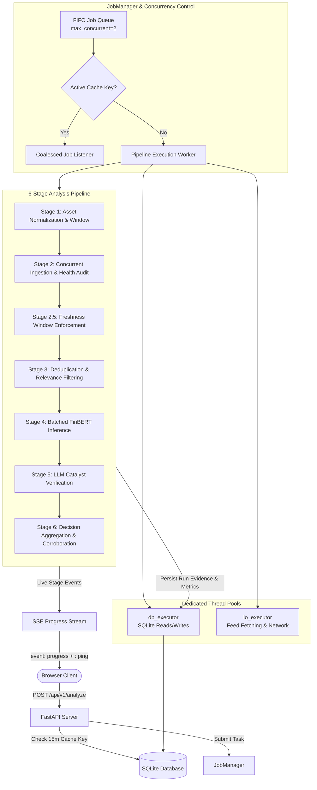

# SentimentPulse — Universal Market Sentiment Intelligence Platform

[](https://www.python.org/)
[](https://fastapi.tiangolo.com/)
[](https://react.dev/)
[](https://huggingface.co/ProsusAI/finbert)
[](LICENSE)
[-success.svg)](#8-test-strategy--verification)

> [!WARNING]
> **LEGAL DISCLAIMER & NON-ADVISORY FRAMING:**  
> SentimentPulse is an **empirical research and market-sentiment exploration tool**, **NOT** financial, investment, legal, or tax advice. All directional classifications (**BUY**, **HOLD**, **SELL**) are generated through uncalibrated mathematical heuristic rules applied strictly to public current-session headlines. No predictive returns, future market performance, or investment recommendations are implied or guaranteed.

---

## 1. Overview

**SentimentPulse** is an enterprise-grade market sentiment research platform and dual-stage neural analysis engine. It ingests current-session financial headlines across premier global publishers, filters noise and syndication duplicates, analyzes directional polarity using a locally hosted FinBERT transformer model, audits market-moving catalysts via OpenRouter LLMs (Nvidia Nemotron 3 Ultra / Super), and computes an uncalibrated directional verdict (**BUY**, **HOLD**, or **SELL**).

### Key Capabilities

- **Universal Multi-Asset Coverage**:
  - **Equities & ETFs**: `$NVDA`, `$AAPL`, `$MSFT`, `$TSLA`, `$SPY`, `$QQQ`, `$BRK-B`
  - **Forex Currency Pairs**: `EUR/USD`, `USD/JPY`, `GBP/USD`, `AUD/USD`, `EURUSD=X`
  - **Commodities & Futures**: `GC=F` (Gold), `CL=F` (Crude Oil), `SI=F` (Silver), `NG=F` (Natural Gas). Prefixing with `$` (e.g., `$GOLD`, `$CORN`) bypasses commodity aliases to resolve listed equity instruments.
  - **Cryptocurrencies**: `BTC-USD` (Bitcoin), `ETH-USD` (Ethereum), `SOL-USD` (Solana)
- **Concurrent Ingestion & Provider Outcome Tracking**:
  - Parallel multi-source ingestion: Yahoo Finance API and Google News RSS aggregator feeds, plus dedicated Forex feeds (Investing.com Forex, FXStreet).
  - Explicit provider health tracking (`ProviderOutcome`) recording latency, article counts, and error statuses.
  - Graceful degradation: feed outages emit audited non-cacheable runs (`data_status: "DEGRADED"`).
- **Session-Anchored Temporal Windows (Unified Decision D1 Rule)**:
  - Strict lookback calculations anchored to `America/New_York` (ET) timezone with verified NYSE calendar (holidays, special closures, and 13:00 ET early closes).
  - Unified window rule: starts at the close of the most recent prior active trading day (16:00 ET, or 13:00 after early closes), capped at $\max(T_{\text{prior\_close}}, T_{\text{run}} - 72\text{h})$, ending at `run`. Captures after-hours earnings and weekend developments.
- **Ratio-Based Decision Matrix & Two-Publisher Corroboration**:
  - Isolates directional headlines ($|S_i| \ge 0.15$) and evaluates ratio criteria ($N_{\text{pos}} \ge 1.5 \times N_{\text{neg}}$ for BUY; $N_{\text{neg}} \ge 1.5 \times N_{\text{pos}}$ for SELL).
  - Strict corroboration: BUY/SELL verdicts require $\ge 2$ distinct eligible canonical publishers supporting the verdict direction; otherwise forces HOLD with `INSUFFICIENT_CORROBORATION`.
- **Two-Stage Hybrid Scoring**:
  - **Stage 1 (Local NLP)**: Batched sentiment inference ($P_{\text{pos}}, P_{\text{neg}}, P_{\text{neu}}$) via `ProsusAI/finbert`.
  - **Stage 2 (Single-Batch Catalyst Verification)**: High-speed catalyst audit bundling candidate headlines into a single structured prompt via OpenRouter.
- **Non-Blocking Concurrency & Real-Time Streaming**:
  - Dedicated worker thread pools (`db_executor` and `io_executor`) keeping the FastAPI event loop responsive (<200 ms latency under concurrent load).
  - Centralized `JobManager` with global concurrency limit (`MAX_CONCURRENT_PIPELINES=2`), queue position tracking, and cache-key request coalescing.
  - Real-time Server-Sent Events (SSE) streaming progress stages (`event: progress`) with periodic keepalive heartbeats (`: ping\n\n`).
- **Security & Data Lifecycle**:
  - Scoped sliding-window rate limiting, bounded LRU key store, and right-to-left proxy IP resolution with CIDR trusted proxies.
  - Optional API key authentication and daily LLM spending caps.
  - Automatic data retention lifecycle (hourly purging of expired jobs and 30-day run history with cascading deletes).

---

## 2. System Architecture



---

## 3. Decision Model & Mathematical Formulas

### Core Freshness Invariant & Unified Session Window (D1)
Every article evaluated by FinBERT, the LLM, or the aggregator MUST possess a verified publication timestamp inside the active market session window $[T_{\text{start}}, T_{\text{end}} + 5\text{m}]$ (`America/New_York` market clock).
- **Unified Window Rule (Decision D1)**: $T_{\text{start}}$ is anchored to the closing bell of the most recent active NYSE trading day strictly prior to today's date (16:00 ET, or 13:00 ET on early close days), capped at $\max(T_{\text{prior\_close}}, T_{\text{run}} - 72\text{h})$. $T_{\text{end}} = T_{\text{run}}$.
- Missing timestamps are never defaulted to `now()`.
- Out-of-window articles are filtered into an excluded sample; an explicit pre-aggregation domain assertion raises `FreshnessViolationException` if an expired headline reaches scoring.
- When zero headlines satisfy freshness, the engine returns a clean HOLD with `data_status: "NO_FRESH_NEWS"`.

### Effective Article Weights & Recency Decay
Headlines lose informational momentum over time. Each article's base weight is decayed exponentially using a 14-hour half-life:
$$\lambda = \frac{\ln(2)}{14.0} \approx 0.04951$$
$$W_{\text{decay}} = e^{-\lambda \cdot \Delta t_{\text{hours}}}$$
$$W_{\text{effective}} = W_{\text{decay}} \cdot \max(0.20, W_{\text{final}})$$
The effective weight is computed once per article, ensuring the numerator and denominator sums are strictly identical across tally stages.

### FinBERT Directional Polarity ($S_i$)
To prevent neutral market wrap dominance from zeroing valid signals:
$$S_i = \begin{cases} 
0.0 & \text{if } |P_{\text{pos}} - P_{\text{neg}}| < 0.15 \\ 
P_{\text{pos}} - P_{\text{neg}} & \text{if } |P_{\text{pos}} - P_{\text{neg}}| \ge 0.15 
\end{cases}$$
Directional articles carry weight proportional to certainty: $W_i = \text{confidence} \cdot (1.0 - P_{\text{neu}})$.

### Composite Directional Sentiment Score ($S$)
Calculated strictly across directional headlines ($|S_i| \ge 0.15$):
$$S = \frac{\sum_{i \in \text{Directional}} W_{\text{effective}, i} \cdot S_i}{\sum_{i \in \text{Directional}} W_{\text{effective}, i}} \in [-1.0, +1.0]$$

### Ratio Decision Matrix & Directional Publisher Corroboration
$$\text{Verdict} = \begin{cases} 
\mathbf{BUY} & \text{if } N_{\text{pos}} \ge 2 \text{ and } N_{\text{pos}} \ge 1.5 \times N_{\text{neg}} \text{ and } S \ge +0.20 \text{ and } P_{\text{pos}} \ge 2 \\ 
\mathbf{SELL} & \text{if } N_{\text{neg}} \ge 2 \text{ and } N_{\text{neg}} \ge 1.5 \times N_{\text{pos}} \text{ and } S \le -0.20 \text{ and } P_{\text{neg}} \ge 2 \\ 
\mathbf{HOLD} & \text{if } P_{\text{support}} < 2 \text{ (forced HOLD with INSUFFICIENT\_CORROBORATION)} \\ 
\mathbf{HOLD} & \text{if conflicting sentiment } (N_{\text{pos}}, N_{\text{neg}} \ge 1 \text{ within } 1.5\times \text{ ratio corridor}) \\ 
\mathbf{HOLD} & \text{if sparse evidence } (N_{\text{pos}} + N_{\text{neg}} < 2) \\
\mathbf{HOLD} & \text{if neutral sentiment } (-0.20 < S < +0.20)
\end{cases}$$

- **Directional Corroboration ($P_{\text{support}}$)**: BUY candidates require at least 2 distinct eligible canonical publishers supporting the positive side ($P_{\text{pos}} \ge 2$). SELL candidates require at least 2 distinct eligible canonical publishers supporting the negative side ($P_{\text{neg}} \ge 2$).
- **Eligible Publishers**: Feed sweep entries with `publisher_inferred=True` (such as Google News fallback sweeps lacking explicit `<source>` metadata) and entries tagged as `"Unknown Aggregator"` are strictly excluded from corroboration counts.

### Decision Confidence & Dynamic Ceilings (Decision D6)
Raw decision confidence is calculated from directional sentiment certainty, consensus alignment, and evidence quality:
$$C_{\text{raw}} = |S| \times \left(0.4 + 0.6 \times \frac{|N_{\text{pos}} - N_{\text{neg}}|}{N_{\text{pos}} + N_{\text{neg}}}\right) \times Q$$

- **Evidence-Free / Sparse Evidence HOLDs**: If $N_{\text{pos}} + N_{\text{neg}} < 2$ (`SPARSE_EVIDENCE` or `NO_NEWS`), confidence is strictly **0.0** (displayed as `n/a` in the UI).
- **Hybrid High-Confidence Ceiling ($0.95$)**: Applies **only** when LLM catalyst synthesis succeeded and verified $\ge 1$ market-moving catalyst directly supporting the verdict's direction.
- **Baseline Ceiling ($0.60$)**: Confidence is bounded to $[0.15, 0.60]$ whenever the pipeline runs in FinBERT-only mode, the LLM fails or times out, no supporting catalyst is confirmed, or the verdict is a directional HOLD.

### Data Statuses & HOLD Reasons

| Data Status | Description | Action & Caching |
|---|---|---|
| `OK` | Normal analysis with verified in-window news. | Standard intraday cache TTL. |
| `NO_FRESH_NEWS` | Zero articles published inside active session window. | HOLD (`NO_NEWS`); cache TTL capped at $\min(\text{bucket}, 300\text{s})$. |
| `NO_RELEVANT_NEWS` | In-window headlines found, but zero passed entity relevance filters. | HOLD (`NO_NEWS`); FinBERT/LLM skipped; cache TTL capped at $\min(\text{bucket}, 300\text{s})$. |
| `DEGRADED` | All external news providers or RSS feeds failed during sweep. | Persisted for auditability; `is_cacheable=False` (never served from cache). |

| HOLD Reason | Definition |
|---|---|
| `NO_NEWS` | Zero articles found in session window or zero passed relevance. Confidence: `0.0`. |
| `SPARSE_EVIDENCE` | Directional evidence volume is insufficient ($N_{\text{pos}} + N_{\text{neg}} < 2$). Confidence: `0.0`. |
| `INSUFFICIENT_CORROBORATION` | Ratio threshold was met, but evidence came from a single publisher ($P_{\text{support}} < 2$). |
| `CONFLICTING` | Opposing positive and negative catalysts balance within the $1.5\times$ ratio corridor. |
| `NEUTRAL` | Directional sentiment score falls within the neutral corridor ($-0.20 < S < +0.20$). |

---

## 4. API Reference

All API routes are served under `/api/v1`.

### Endpoints

| Method | Endpoint | Description | Rate Limit |
|---|---|---|---|
| `POST` | `/api/v1/analyze` | Submit a ticker for analysis or return coalesced in-flight job. | 15 / min |
| `GET` | `/api/v1/jobs/{id}` | Inspect background job status and progress. | 60 / min |
| `GET` | `/api/v1/jobs/{id}/events` | Real-time Server-Sent Events (SSE) progress stream. | 60 / min |
| `GET` | `/api/v1/analysis/{id}` | Retrieve completed analysis run record and evidence. | 120 / min |
| `GET` | `/api/v1/history` | List recent analysis runs with timestamps and verdicts. | 120 / min |
| `GET` | `/api/v1/health` | Service health, DB connectivity, and FinBERT warmup status. | Unmetered |

### Background Job Statuses

- `QUEUED`: Waiting in FIFO queue for a free worker slot.
- `PROCESSING`: Pipeline actively executing across ingestion, scoring, or synthesis.
- `COMPLETED`: Analysis successfully finished; `run_id` available.
- `FAILED`: Analysis aborted; `error_message` available.
- `CANCELLED`: Analysis terminated during server shutdown or job cancellation.

### Server-Sent Events (SSE) Protocol

Clients stream job events by connecting to `GET /api/v1/jobs/{job_id}/events`. The server emits:
- Stage updates:
  ```
  event: progress
  data: {"stage": "FINBERT_SCORING", "progress_pct": 0.70, "message": "Running local FinBERT inference..."}
  ```
- Completion event:
  ```
  event: completed
  data: {"job_id": "...", "status": "COMPLETED", "run_id": "..."}
  ```
- Failure event:
  ```
  event: failed
  data: {"job_id": "...", "status": "FAILED", "error_code": "INGESTION_ERROR", "error_message": "..."}
  ```
- Keepalive heartbeats:
  ```
  : ping
  ```
  Emitted every 15 seconds to prevent reverse proxy read timeouts.

### Unified Error Responses

All error responses return a standardized JSON structure with HTTP status codes:
```json
{
  "error": "InvalidTickerException",
  "message": "Invalid ticker 'INVALID$$$': Invalid ticker format",
  "details": {
    "ticker": "INVALID$$$",
    "reason": "Invalid ticker format"
  }
}
```
Rate-limited requests (HTTP 429) include a `Retry-After: <seconds>` header.

---

## 5. Configuration Reference

All settings can be configured via environment variables or a `.env` file anchored to the project root:

| Setting | Type | Default | Description |
|---|---|---|---|
| `APP_ENV` | `str` | `production` | Application environment (`development`, `test`, `production`). |
| `LOG_LEVEL` | `str` | `INFO` | Logging level (`DEBUG`, `INFO`, `WARNING`, `ERROR`). |
| `APP_HOST` | `str` | `127.0.0.1` | Host address for `python -m app` uvicorn server. |
| `APP_PORT` | `int` | `8000` | Port for `python -m app` uvicorn server. |
| `DATABASE_URL` | `str` | `sqlite:///./data/sentiment.db` | SQLAlchemy connection string (resolved relative to root). |
| `RUN_MIGRATIONS_ON_STARTUP` | `bool` | `true` | Conditionally run Alembic migrations on startup lifespan. |
| `HTTP_USER_AGENT` | `str` | `SentimentPulse/1.1 (+research)` | Outbound HTTP User-Agent header for RSS sweeps. |
| `API_KEY` | `str` | `""` | Optional shared secret for `X-API-Key` authentication (empty = off). |
| `PUBLIC_HISTORY` | `bool` | `true` | Allow unauthenticated reads of `/history` and `/analysis/{id}`. |
| `RATE_LIMIT_READ_PER_MINUTE` | `int` | `120` | Max requests/minute per client IP for read endpoints. |
| `TRUSTED_PROXY_IPS` | `list[str]` | `[]` | Trusted reverse proxy IPs/CIDRs for `X-Forwarded-For` resolution. |
| `CACHE_BUCKET_MINUTES` | `int` | `15` | Session cache bucket window size in minutes. |
| `TICKER_CACHE_TTL_SECONDS` | `int` | `21600` | Positive ticker resolution in-memory TTL (6 hours). |
| `TICKER_RESOLUTION_TIMEOUT_SECONDS` | `int` | `15` | Max duration for Yahoo Finance ticker resolution. |
| `INGESTION_TIMEOUT_SECONDS` | `int` | `20` | Max duration for concurrent news ingestion sweep. |
| `YF_NEWS_COUNT` | `int` | `50` | Target headline count for Yahoo Finance API queries. |
| `FEED_RETRY_ATTEMPTS` | `int` | `2` | Retry attempts for failing RSS feeds. |
| `FINBERT_MODEL_NAME` | `str` | `ProsusAI/finbert` | Hugging Face model identifier for FinBERT. |
| `FINBERT_BATCH_SIZE` | `int` | `16` | Batch size for FinBERT transformer tokenization & inference. |
| `FINBERT_PRELOAD` | `bool` | `true` | Warm up FinBERT model in background during server startup. |
| `FINBERT_TORCH_THREADS` | `int` | `0` | Torch CPU threads limit (0 uses PyTorch default). |
| `ENABLE_LLM` | `bool` | `true` | Enable Stage 5 LLM catalyst synthesis. |
| `OPENROUTER_API_KEY` | `str` | `""` | OpenRouter API authentication key. |
| `LLM_MODEL_ID` | `str` | `nvidia/nemotron-3-ultra-550b-a55b:free` | Primary LLM model identifier. |
| `LLM_FALLBACK_MODEL_ID` | `str` | `nvidia/nemotron-3-super-120b-a12b:free` | Automatic fallback model identifier. |
| `LLM_TIMEOUT_SECONDS` | `int` | `30` | End-to-end timeout for catalyst synthesis. |
| `LLM_REQUEST_TIMEOUT_SECONDS` | `int` | `20` | Per-attempt HTTP request timeout for OpenRouter API. |
| `LLM_MAX_RETRIES` | `int` | `1` | Retry attempts on OpenRouter connection failure. |
| `LLM_JSON_MODE` | `bool` | `true` | Request strict `response_format: {type: "json_object"}`. |
| `LLM_REASONING_EFFORT` | `str` | `low` | Reasoning effort parameter for thinking models. |
| `LLM_DAILY_BUDGET_USD` | `float` | `1.00` | Maximum daily spend cap for OpenRouter API calls. |
| `MAX_PROMPT_TOKENS` | `int` | `4000` | Maximum prompt token budget for candidate articles. |
| `MAX_CANDIDATE_ARTICLES_TO_LLM` | `int` | `12` | Maximum articles forwarded to catalyst synthesis. |
| `MAX_RETAINED_ARTICLES` | `int` | `350` | Maximum articles retained after deduplication. |
| `MAX_EXCLUDED_SAMPLES_PER_REASON` | `int` | `20` | Maximum excluded articles stored per reason in database. |
| `RUN_RETENTION_DAYS` | `int` | `30` | Retention duration for historical analysis runs. |
| `MAX_CONCURRENT_PIPELINES` | `int` | `2` | Maximum simultaneous pipeline executions. |
| `JOB_QUEUE_TIMEOUT_SECONDS` | `int` | `120` | Maximum duration a job can wait in queue before timing out. |
| `PIPELINE_TIMEOUT_SECONDS` | `int` | `180` | Maximum overall execution timeout for analysis job. |
| `SSE_HEARTBEAT_SECONDS` | `int` | `15` | Interval for `: ping\n\n` keepalive comments. |

---

## 6. Known Limitations & Operating Constraints

1. **Single-Worker In-Process Job Architecture**: The backend executes background jobs using an in-process `JobManager` with SQLite persistence. It is designed to run with `workers = 1`. If the server process restarts, active in-flight jobs are cleanly marked `CANCELLED`; distributed queues (e.g., Celery, Redis) are out of scope.
2. **Reverse Proxy Configuration**: In production, deploy behind a reverse proxy (e.g., Nginx, Caddy). Ensure `X-Forwarded-For` is forwarded and configure `TRUSTED_PROXY_IPS` in `.env` so rate limiting accurately tracks client IPs.
3. **Google News Redirect Links**: Google News RSS URLs are redirected publisher links. SentimentPulse strips Google tracking tags and cleans URLs to canonical forms, but does not perform HTTP roundtrip unmasking of full redirect targets.
4. **Free-Model Rate Limits**: Free OpenRouter models may occasionally experience upstream congestion or provider rate limits. The engine automatically retries on the configured fallback model (`LLM_FALLBACK_MODEL_ID`), and degrades cleanly to deterministic FinBERT-only scoring if all LLM attempts fail.

---

## 7. Measured Performance

Benchmarks conducted on a representative developer workstation (Windows 11, Intel Core i7, 16 GB RAM, CPU-only PyTorch):

| Pipeline Stage | Articles Handled | Measured Duration |
|---|---|---|
| Ingestion Sweep (Yahoo + RSS) | 30–80 raw articles | 1.8 – 3.5 s |
| Ingestion Sweep (Forex multi-feed) | 50–120 raw articles | 2.5 – 4.2 s |
| Deduplication & Relevance Filtering | Up to 150 articles | 15 – 40 ms |
| Batched FinBERT Inference (Batch size 16) | 30 articles | 4.2 – 6.8 s (~180 ms / article) |
| Batched FinBERT Inference (Batch size 16) | 100 articles | 14.0 – 19.5 s (~165 ms / article) |
| OpenRouter LLM Catalyst Synthesis | 12 candidates (1 prompt) | 2.5 – 5.5 s |
| Decision Aggregation & SQLite Persist | Complete run record | 25 – 45 ms |
| **Full End-to-End Pipeline** | **Typical 30–60 article run** | **9.5 – 16.5 s** |

---

## 8. Test Strategy & Verification

The test suite enforces complete network isolation by default, mocks external network calls, uses frozen clock timestamps, and includes dedicated pytest markers:

```bash
# 1. Run full offline test suite with coverage check (284 tests, ~15s)
pytest --cov=app --cov-report=term-missing --cov-fail-under=85

# 2. Run real FinBERT model inference tests (loads cached Hugging Face model)
pytest -m slow

# 3. Run opt-in live provider sweeps (requires active Internet connection)
pytest -m live

# 4. Check Alembic database migrations & schema drift
alembic check

# 5. Run Python linter & code quality checks
ruff check .

# 6. Run Frontend typecheck and unit tests (requires Node 20+ / 24+ LTS)
cd frontend
npm.cmd run typecheck
npm.cmd test
npm.cmd run build
```

---

## 9. Installation & Getting Started

### Prerequisites
- **Python**: Version 3.11 or 3.12
- **Node.js**: Version 20+ or 24+ LTS (Windows: use `npm.cmd`)
- **Git**

### Backend Setup

```powershell
# 1. Clone repository
git clone https://github.com/elem160/Market-Sentiment-2.git
cd "Market Sentiment 2"

# 2. Create virtual environment & install dependencies
python -m venv .venv
.\.venv\Scripts\Activate.ps1
pip install -r requirements.txt
pip install -r requirements-dev.txt

# 3. Configure environment
copy .env.example .env
# Edit .env to add your OPENROUTER_API_KEY (optional, enables Stage 5 LLM verification)

# 4. Run database migrations
alembic upgrade head

# 5. Start development backend server
python -m app
# Backend listens on http://127.0.0.1:8000
```

### Frontend Setup

```powershell
# In a separate terminal:
cd frontend

# 1. Install dependencies
npm.cmd ci

# 2. Start Vite development server
npm.cmd run dev
# Frontend listens on http://localhost:5173 (proxies /api to http://127.0.0.1:8000)
```

---

## 10. Repository Structure

```
Market Sentiment 2/
├── alembic/                      # Database migration scripts (001–005)
│   ├── env.py                    # Migration configuration & model registration
│   └── versions/                 # Versioned migration files
├── app/                          # Core Python application package
│   ├── api/                      # API routing, dependencies & schemas
│   │   ├── dependencies.py       # Rate limiting & proxy IP resolution
│   │   ├── routes.py             # REST endpoints & SSE streaming
│   │   └── schemas.py            # Pydantic v2 contract models
│   ├── core/                     # Domain invariants, models & enums
│   │   ├── constants.py          # Threshold constants (DIRECTIONAL_THRESHOLD)
│   │   ├── enums.py              # Domain enums (AssetType, DecisionVerdict, etc.)
│   │   ├── exceptions.py         # Application exceptions hierarchy
│   │   ├── market_calendar.py    # NYSE calendar & holiday schedule
│   │   ├── models.py             # Domain data models & dataclasses
│   │   └── session_window.py     # Unified session window (Decision D1)
│   ├── db/                       # Persistence layer
│   │   ├── database.py           # Engine & SessionLocal setup
│   │   ├── models.py             # SQLAlchemy ORM models
│   │   ├── repository.py         # SentimentRepository CRUD operations
│   │   └── types.py              # Custom UTCDateTime type decorator
│   ├── services/                 # Business logic & stage services
│   │   ├── aggregator_service.py # Ratio decision matrix & corroboration
│   │   ├── deduplication_service.py # URL cleaning & Jaccard deduplication
│   │   ├── finbert_service.py    # FinBERT inference & scoring protocol
│   │   ├── job_manager.py        # Concurrency semaphore & request coalescing
│   │   ├── llm_service.py        # OpenRouter catalyst synthesis
│   │   ├── maintenance.py        # Data retention lifecycle & job purging
│   │   ├── news_service.py       # Concurrent feed ingestion & health audits
│   │   ├── orchestrator.py       # Decomposed 6-stage PipelineContext pipeline
│   │   ├── relevance.py          # Multi-asset entity relevance matcher
│   │   ├── scoring.py            # SentimentScorer protocol & batching
│   │   └── ticker_service.py     # Symbol normalization & asset validation
│   ├── utils/                    # Shared utilities
│   │   ├── executors.py          # Dedicated db and io thread pools
│   │   ├── logging.py            # Structured logging setup
│   │   └── rate_limiter.py       # Sliding-window LRU rate limiter
│   ├── cli.py                    # Command-line maintenance runner
│   ├── config.py                 # Pydantic Settings & path anchoring
│   └── main.py                   # FastAPI application & lifespan management
├── docs/                         # Documentation & historical records
│   ├── CHANGELOG.md              # Semantic version changelog
│   ├── auditor_progress_handover.md # Auditor remediation handover
│   ├── implementation_log.md     # Task-by-task execution log
│   ├── implementation_plan.md    # Master architectural remediation plan
│   └── history/                  # Archived planning documents
├── frontend/                     # React 19 + TypeScript frontend application
│   ├── src/
│   │   ├── api/                  # OpenAPI snapshot & TypeScript schema
│   │   ├── components/           # UI components (DecisionHero, EvidenceExplorer, etc.)
│   │   ├── services/             # API client & SSE consumer
│   │   └── styles/               # Glassmorphism dark CSS theme
│   ├── package.json              # Frontend dependencies & scripts
│   └── vite.config.ts            # Vite build & proxy configuration
├── scripts/                      # Utility scripts (export_openapi.py, bench_finbert.py)
├── tests/                        # Comprehensive test suite (284 tests)
│   ├── contract/                 # OpenAPI & SSE contract tests
│   ├── e2e/                      # End-to-end API route tests
│   ├── fixtures/                 # Static JSON fixture articles
│   ├── integration/              # Database, migration & pipeline tests
│   ├── unit/                     # Focused unit tests
│   └── conftest.py               # Shared test fixtures & network guard
├── pyproject.toml                # Project metadata & tightened Ruff configuration
└── pytest.ini                    # Pytest markers & test settings
```
