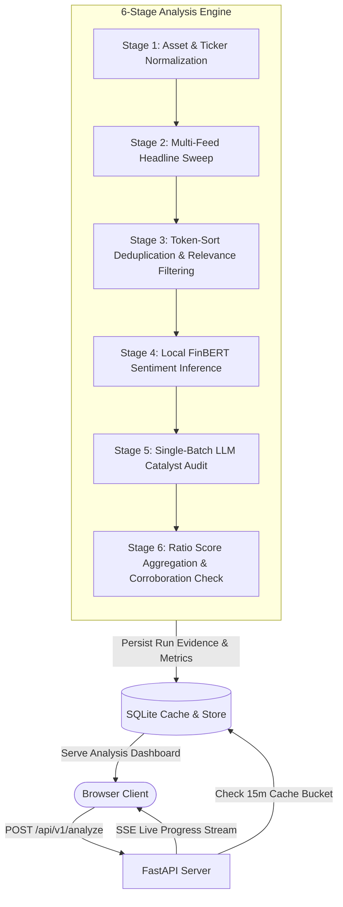

# SentimentPulse — Universal Market Sentiment Intelligence Platform

[](https://www.python.org/)
[](https://fastapi.tiangolo.com/)
[](https://react.dev/)
[](https://huggingface.co/ProsusAI/finbert)
[](LICENSE)

> [!WARNING]
> **LEGAL DISCLAIMER & NON-ADVISORY FRAMING:**  
> SentimentPulse is an **empirical research and market-sentiment exploration platform**, **NOT** financial, investment, legal, or tax advice. All directional classifications (**BUY**, **HOLD**, **SELL**) are generated through uncalibrated mathematical heuristic formulas applied strictly to public current-session headlines. No predictive returns or future market performance are implied or guaranteed.

---

## 1. Overview

**SentimentPulse** is an enterprise-grade market sentiment research platform and dual-stage neural analysis engine. It ingests hundreds of current-session financial headlines across premier global publishers, filters noise and lists, analyzes directional polarity using a locally hosted FinBERT transformer model, audits market-moving catalysts via OpenRouter LLMs (Nvidia Nemotron 3 Ultra), and delivers a clear, uncalibrated directional verdict (**BUY**, **HOLD**, or **SELL**).

### Core Features

- **Universal Multi-Asset Coverage**:
  - **Equities & ETFs**: `$NVDA`, `$AAPL`, `$MSFT`, `$TSLA`, `$SPY`, `$QQQ`, `$BRK-B`
  - **Forex Currency Pairs**: `EUR/USD`, `USD/JPY`, `GBP/USD`, `AUD/USD`, `EURUSD=X`
  - **Commodities & Futures**: `GC=F` (Gold), `CL=F` (Crude Oil), `SI=F` (Silver), `NG=F` (Natural Gas). *Note: Prefixing with `$` (e.g., `$GOLD`, `$CORN`) bypasses commodity aliases to resolve listed equity instruments.*
  - **Cryptocurrencies**: `BTC-USD` (Bitcoin), `ETH-USD` (Ethereum), `SOL-USD` (Solana)
- **High-Throughput Multi-Feed Ingestion (100–350+ Headlines)**:
  - Parallel multi-source sweep: Yahoo Finance (API + RSS), Google News RSS (Reuters, Bloomberg, CNBC, Wall Street Journal, MarketWatch, Seeking Alpha, Motley Fool), and dedicated Forex feeds (Investing.com Forex, FXStreet).
  - Fast headline-focused pipeline: bypasses bulky body scraping to execute sweeps in 2–3 seconds while preserving crucial contextual signals.
- **Ratio-Based Scoring (The HOLD Problem Solved)**:
  - Traditional sentiment aggregators squash directional signals toward neutral when flooded with generic market wraps. SentimentPulse isolates directional headlines and uses a robust ratio decision matrix ($N_{\text{pos}} \ge 1.5 \times N_{\text{neg}} \implies \text{BUY}$, $N_{\text{neg}} \ge 1.5 \times N_{\text{pos}} \implies \text{SELL}$).
- **Two-Stage Hybrid Intelligence**:
  - **Stage 1 (Local NLP)**: Fine-grained sentiment classification ($P_{\text{pos}}, P_{\text{neg}}, P_{\text{neu}}$) via `ProsusAI/finbert`.
  - **Stage 2 (Single-Batch Catalyst Verification)**: High-speed catalyst audit bundling candidate headlines into a single prompt for `nvidia/nemotron-3-ultra-550b-a55b:free` (with seamless automatic failover to `nvidia/nemotron-3-super-120b-a12b:free`).
- **Session-Anchored Temporal Windows**:
  - Strict lookback calculations anchored to `America/New_York` (ET) timezone: Pre-Market, Regular Trading Hours (RTH), Post-Market, and Weekend/Holiday lookbacks (anchored to Friday 16:00 ET close, capped at 72 hours).
- **Asynchronous Execution & Streaming UI**:
  - In-app durable worker architecture with per-ticker request coalescing (prevents duplicate API sweeps under concurrent load).
  - Real-time progress updates streamed via Server-Sent Events (SSE).
  - Clean, responsive React 19 + TypeScript frontend with a glassmorphism dark theme.

---

## 2. System Architecture



---

## 3. Decision Matrix & Mathematical Formulas

### Recency Decay
Headlines lose informational momentum over time. Each article's base weight is decayed exponentially using a 14-hour half-life:
$$\lambda = \frac{\ln(2)}{14.0} \approx 0.0495$$
$$W_{\text{decay}} = e^{-\lambda \cdot \Delta t_{\text{hours}}}$$

### Composite Directional Sentiment Score ($S$)
To prevent neutral dilution, the composite score is calculated strictly across directional headlines ($|S_i| \ge 0.15$):
$$S = \frac{\sum_{i \in \text{Directional}} W_i \cdot S_i}{\sum_{i \in \text{Directional}} W_i} \in [-1.0, +1.0]$$

### Ratio Decision Matrix
$$\text{Verdict} = \begin{cases} 
\mathbf{BUY} & \text{if } N_{\text{pos}} \ge 2 \text{ and } N_{\text{pos}} \ge 1.5 \times N_{\text{neg}} \text{ and } S \ge +0.20 \\ 
\mathbf{SELL} & \text{if } N_{\text{neg}} \ge 2 \text{ and } N_{\text{neg}} \ge 1.5 \times N_{\text{pos}} \text{ and } S \le -0.20 \\ 
\mathbf{HOLD} & \text{if conflicting sentiment } (N_{\text{pos}}, N_{\text{neg}} \ge 1 \text{ within } 1.5\times \text{ ratio}) \\ 
\mathbf{HOLD} & \text{if sparse evidence } (N_{\text{pos}} + N_{\text{neg}} < 2) 
\end{cases}$$

---

## 4. Project Structure

```
Market Sentiment/
├── app/
│   ├── api/
│   │   ├── dependencies.py       # Rate limiting & IP resolution
│   │   ├── routes.py             # FastAPI REST & SSE endpoints
│   │   └── schemas.py            # Pydantic v2 request/response models
│   ├── core/
│   │   ├── enums.py              # AssetType, ProviderType, DecisionVerdict
│   │   ├── exceptions.py         # Custom domain exceptions
│   │   ├── models.py             # IngestedArticle, ScoredArticle, AnalysisResult
│   │   └── session_window.py     # America/New_York temporal market clock
│   ├── db/
│   │   ├── database.py           # SQLAlchemy SQLite engine (WAL mode)
│   │   └── repository.py         # Job and run persistence operations
│   ├── services/
│   │   ├── aggregator_service.py # Ratio decision matrix & evidence scoring
│   │   ├── deduplication_service.py # Token-Sort Jaccard clustering & entity relevance
│   │   ├── finbert_service.py    # Local ProsusAI/finbert CPU inference
│   │   ├── llm_service.py        # Single-batch OpenRouter catalyst verification
│   │   ├── news_service.py       # Multi-feed headline sweep (Yahoo, Google RSS, FX)
│   │   ├── orchestrator.py       # 6-stage async pipeline coordinator
│   │   └── ticker_service.py     # Multi-asset ticker resolution & alias mapping
│   ├── static/                   # Compiled production frontend bundle
│   ├── config.py                 # Pydantic BaseSettings & model cost estimators
│   └── main.py                   # FastAPI application factory & static mounting
├── frontend/                     # React 19 + TypeScript + Vite SPA
│   ├── src/
│   │   ├── components/           # SearchBar, MetricsCard, EvidenceList, etc.
│   │   ├── types/                # Frontend TypeScript data interfaces
│   │   ├── App.tsx               # Main application container
│   │   └── index.css             # Glassmorphic dark design system
│   ├── package.json
│   └── vite.config.ts
├── tests/
│   ├── unit/                     # Unit tests for all individual services
│   ├── integration/              # Caching, lock coalescing, pipeline tests
│   └── e2e/                      # FastAPI client endpoint tests
├── .env.example                  # Environment configuration template
├── pytest.ini                    # Pytest configuration
├── requirements.txt              # Production Python dependencies
└── README.md
```

---

## 5. Getting Started

### Prerequisites
- **Python**: 3.11, 3.12, or 3.13
- **Node.js**: 18+ (optional; the repository includes the pre-compiled frontend in `app/static/`)
- **OpenRouter API Key** (optional, for LLM catalyst extraction): Obtain a free key from [OpenRouter](https://openrouter.ai/).

### 1. Installation

```bash
# Clone the repository
git clone https://github.com/<your-username>/market-sentiment.git
cd market-sentiment

# Create and activate virtual environment
python -m venv venv
# On Windows:
.\venv\Scripts\activate
# On Linux/macOS:
source venv/bin/activate

# Install dependencies
pip install -r requirements.txt
```

### 2. Environment Configuration

Copy `.env.example` to `.env`:
```bash
cp .env.example .env
```

Edit `.env` with your preferred configuration:
```ini
APP_ENV=development
APP_HOST=127.0.0.1
APP_PORT=8000
DATABASE_URL=sqlite:///./data/sentiment.db

# Neural Models
FINBERT_MODEL_NAME=ProsusAI/finbert
LLM_MODEL_ID=nvidia/nemotron-3-ultra-550b-a55b:free
ENABLE_LLM=true

# OpenRouter Credentials
OPENROUTER_API_KEY=your_openrouter_api_key_here
```

### 3. Build Frontend (Optional if using pre-bundled assets)

```bash
cd frontend
npm install
npm run build
cd ..
```

### 4. Run the Application

```bash
python -m uvicorn app.main:app --host 127.0.0.1 --port 8000
```

Open your browser at **`http://localhost:8000`**.

---

## 6. API Reference

### Analyze Ticker
`POST /api/v1/analyze`
```json
{
  "ticker": "NVDA",
  "force_refresh": false,
  "enable_llm": true
}
```
- Returns `200 OK` with full `AnalysisResult` on cache hit.
- Returns `202 Accepted` with `poll_url` and `events_url` (SSE) on fresh job creation.

### Stream Progress (SSE)
`GET /api/v1/jobs/{job_id}/events`
Streams real-time pipeline progress events:
```
event: progress
data: {"stage": "FINBERT_SCORING", "progress_pct": 0.70, "message": "Scoring 180 articles..."}
```

### Get Job Status
`GET /api/v1/jobs/{job_id}`
Returns the current job status (`PENDING`, `PROCESSING`, `COMPLETED`, `FAILED`).

### Get Full Analysis Result
`GET /api/v1/analysis/{run_id}`
Returns complete analysis metrics, decision verdict, rationale, and article-by-article evidence.

### Query History
`GET /api/v1/history?limit=15`
Returns recent historical runs for quick dashboard recall.

### Health Check
`GET /api/v1/health`
Returns system status, database connectivity, and model configuration.

---

## 7. Testing

SentimentPulse has a comprehensive test suite covering unit logic, multi-asset resolution, deduplication, caching, and end-to-end API flows.

```bash
# Run the entire test suite
pytest -v

# Run with coverage report
pytest --cov=app tests/
```

All 40 unit, integration, and E2E tests execute and pass out-of-the-box.

---

## 8. License

This project is licensed under the MIT License — see the [LICENSE](LICENSE) file for details.
