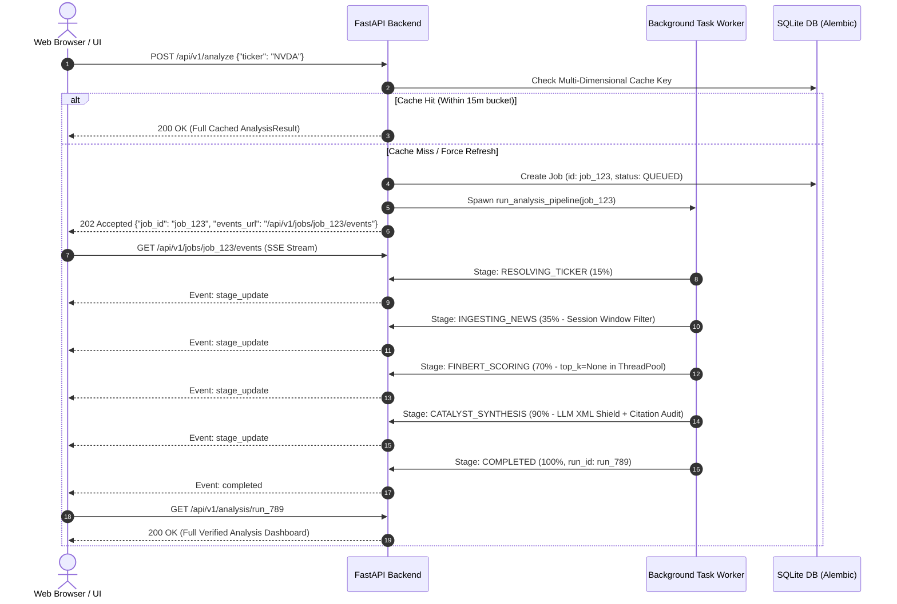

# Implementation Plan: Production-Quality Market Sentiment Analysis Web Application (v2 - Revised)

> **Status**: Ready for User Review & Approval  
> **Target Repository**: `d:\Code Projects\Market Sentiment`  
> **Associated Document**: [IMPLEMENTATION_PLAN.md](file:///d:/Code%20Projects/Market%20Sentiment/IMPLEMENTATION_PLAN.md)  

---

## 1. Goal Description & Scope

Build a reliable, modular, production-quality web application that analyzes **current-day market sentiment** for US-listed equities and ETFs, producing a transparent, non-advisory directional sentiment classification: **BUY**, **HOLD**, or **SELL**.

### Non-Advisory Sentiment Classification Framing
> [!IMPORTANT]
> **Not Financial Advice & Uncalibrated Defaults**:
> - The outputs **BUY**, **HOLD**, and **SELL** are strictly **directional sentiment classifications** reflecting aggregated news tone and verified catalysts. They are **not** investment recommendations, trade signals, or price predictions.
> - All scoring formulas, weights, and decision thresholds are explicitly documented and displayed as **uncalibrated heuristic defaults** until validated through an independent, time-bounded, out-of-sample quantitative backtest.
> - The term "authoritative" is removed from all specifications and UI text.
> - A permanent non-advisory disclaimer is visible across all API payloads and UI views.

### Scope & Asset Rejection (v1)
- **Supported**: US-listed equities and equity ETFs (e.g., `AAPL`, `NVDA`, `MSFT`, `SPY`, `QQQ`).
- **Input Validation**: Normalized server-side (`^[A-Z]{1,5}(-[A-Z]{1,2})?$`).
- **Rejection Policy**: Forex pairs (e.g. `EUR/USD`), Crypto (e.g. `BTC`), and Commodities (e.g. `Crude Oil`) are rejected with an explicit HTTP 422:
  `"Asset class unsupported: Version 1.0 strictly evaluates US-listed Equities and ETFs. Forex and commodities have distinct directional semantics and are scheduled for v2.0."`

---

## 2. User Review Required: Key Revisions Implemented

| Area | User Requirement | Solution in Revised Plan |
| :--- | :--- | :--- |
| **1. "Daily" Window** | Ambiguous 24h rolling window; needs timezone & session rules. | Anchored to **`America/New_York` (ET)**. Defines RTH (09:30-16:00 ET), Pre-market, Post-market, and Weekend/Holiday (capped at 72h). Start/end ISO times, duration, and session type are displayed on every result. |
| **2. Provider Contract** | Vague provider list; unverified licensing claims. | Primary: `yfinance` (`Ticker.news`). Secondary: `Finnhub` REST. Fallback: Google News RSS (documented strictly as an unauthenticated aggregator fallback without implied licensing). Articles with missing or untrustworthy timestamps are excluded. No-news returns clean zero-evidence `HOLD`. |
| **3. FinBERT Correctness** | Top-label only, crude character slicing, blocking async event loop. | Pipeline initialized with `top_k=None` (guaranteeing all 3 class probabilities: positive, negative, neutral). Exact 512-token truncation via HuggingFace tokenizer. CPU inference offloaded to worker thread pool via `asyncio.to_thread`. Neutral articles receive 0.0 directional weight. |
| **4. LLM-to-Decision Logic** | Ambiguity in how LLM verdict modifies scores. | Deterministic rules: LLM-rejected articles are demoted to neutral ($s_i \to 0, w_i \to 0$); confirmed catalysts gain a capped multiplier ($m_i = 1.25$); LLM cannot flip polarity or create sentiment absent in FinBERT. Without LLM, pipeline runs deterministically with confidence capped at 0.60. |
| **5. Prompt Injection & Grounding** | Untrusted external text; ungrounded hallucinations. | Articles isolated in XML tags with prompt injection defense instructions. Every displayed "observed fact" must carry `cited_article_id`. Facts lacking valid cited IDs are automatically pruned. |
| **6. Cache Semantics** | (ticker, date) cache is invalid intraday; thundering herd risk. | Multi-dimensional cache key (ticker, 15m session bucket, provider set, model IDs, config hash). In-memory `TickerLockManager` provides request coalescing per ticker. |
| **7. Live Progress** | Blocking POST makes live stepper dishonest. | Replaced by an **Asynchronous Job Model with Server-Sent Events (SSE)**. `POST /api/v1/analyze` returns 200 (cache hit) or 202 Accepted (`job_id`). `GET /api/v1/jobs/{job_id}/events` streams real-time stage progress to the UI. |
| **8. Persistence & Operations** | Missing model tracking, config version, migrations, frontend tests. | SQLite with **Alembic** migrations. Persists model IDs, config version, provider outcomes, inclusion/exclusion reasons, cache status, and citations. Added frontend linting, type-check, and Vitest component tests. |
| **9. Terminology & Backtesting** | Overpromising language ("authoritative"). | Purged overpromising terms. Outputs defined as directional sentiment classifications. Thresholds explicitly labeled as uncalibrated heuristic defaults. |
| **10. Token & Cost Limits** | Unbounded article or token consumption. | Configurable hard limits: max 15 retained articles, max 5 LLM candidates, max 150 excerpt tokens, max 2000 prompt tokens, max $0.02 USD cost per run. Budget-skipped calls log explicit reason. |
| **11. Scope Focus** | Unnecessary file moves risk losing references. | Existing scripts (`simple_scraper.py`, `bulk_test.py`, `test_hybrid_sentiment.py`, `Sentiment Dataset/`) remain intact in the root directory. Backend foundation and evidence contract prioritized before UI. |

---

## 3. End-to-End System Architecture



---

## 4. Proposed Changes Breakdown

### Backend Core & Services
- [NEW] [`app/main.py`](file:///d:/Code%20Projects/Market%20Sentiment/app/main.py) - FastAPI app, static mounts, lifecycle, CORS.
- [NEW] [`app/config.py`](file:///d:/Code%20Projects/Market%20Sentiment/app/config.py) - Pydantic settings with hard token/cost budget parameters.
- [NEW] [`app/api/routes.py`](file:///d:/Code%20Projects/Market%20Sentiment/app/api/routes.py) - Endpoints: `/api/v1/analyze` (202), `/jobs/{id}/events` (SSE), `/jobs/{id}`, `/analysis/{run_id}`, `/history`, `/health`.
- [NEW] [`app/api/schemas.py`](file:///d:/Code%20Projects/Market%20Sentiment/app/api/schemas.py) - Strict request/response models with session window and citation schemas.
- [NEW] [`app/core/models.py`](file:///d:/Code%20Projects/Market%20Sentiment/app/core/models.py) - Dataclasses: `IngestedArticle`, `ScoredArticle`, `AnalysisResult`, `ObservedFact`.
- [NEW] [`app/core/enums.py`](file:///d:/Code%20Projects/Market%20Sentiment/app/core/enums.py) - `DecisionVerdict`, `SessionType`, `ProviderType`, `CatalystCategory`.
- [NEW] [`app/core/session_window.py`](file:///d:/Code%20Projects/Market%20Sentiment/app/core/session_window.py) - Calculates `America/New_York` trading session windows (RTH, pre-market, post-market, weekends, NYSE holidays).
- [NEW] [`app/services/orchestrator.py`](file:///d:/Code%20Projects/Market%20Sentiment/app/services/orchestrator.py) - 6-Stage Pipeline Coordinator emitting SSE events.
- [NEW] [`app/services/ticker_service.py`](file:///d:/Code%20Projects/Market%20Sentiment/app/services/ticker_service.py) - Symbol validation, normalization, and company resolution.
- [NEW] [`app/services/news_service.py`](file:///d:/Code%20Projects/Market%20Sentiment/app/services/news_service.py) - Multi-provider news ingestion (`yfinance`, Finnhub, RSS fallback) with strict timestamp validation.
- [NEW] [`app/services/deduplication_service.py`](file:///d:/Code%20Projects/Market%20Sentiment/app/services/deduplication_service.py) - URL canonicalizer & Token-Sort Jaccard deduplication.
- [NEW] [`app/services/finbert_service.py`](file:///d:/Code%20Projects/Market%20Sentiment/app/services/finbert_service.py) - FinBERT singleton (`top_k=None`, 512-token truncation, `asyncio.to_thread` event loop protection).
- [NEW] [`app/services/llm_service.py`](file:///d:/Code%20Projects/Market%20Sentiment/app/services/llm_service.py) - OpenRouter catalyst verifier, XML prompt injection shield, citation validation, hard budget limits.
- [NEW] [`app/services/aggregator_service.py`](file:///d:/Code%20Projects/Market%20Sentiment/app/services/aggregator_service.py) - Recency decay ($t_{1/2}=14$h), composite score, quality & confidence metrics, heuristic decision rules.
- [NEW] [`app/db/database.py`](file:///d:/Code%20Projects/Market%20Sentiment/app/db/database.py) - SQLAlchemy engine & SQLite session management.
- [NEW] [`app/db/models.py`](file:///d:/Code%20Projects/Market%20Sentiment/app/db/models.py) - ORM models: `AnalysisRun`, `ArticleEvidence`, `ObservedFact`.
- [NEW] [`app/db/repository.py`](file:///d:/Code%20Projects/Market%20Sentiment/app/db/repository.py) - Persistence, query helpers, and multi-dimensional cache lookups.
- [NEW] [`app/utils/lock_manager.py`](file:///d:/Code%20Projects/Market%20Sentiment/app/utils/lock_manager.py) - Per-ticker request coalescing mutex.
- [NEW] [`alembic/`](file:///d:/Code%20Projects/Market%20Sentiment/alembic/) - Alembic migration versions and configuration.

### Frontend Client
- [NEW] [`frontend/package.json`](file:///d:/Code%20Projects/Market%20Sentiment/frontend/package.json) - React 19, TypeScript, Vite, Lucide React, Vitest.
- [NEW] [`frontend/src/styles/index.css`](file:///d:/Code%20Projects/Market%20Sentiment/frontend/src/styles/index.css) - Vanilla CSS design system (dark mode, glassmorphism, responsive typography).
- [NEW] [`frontend/src/App.tsx`](file:///d:/Code%20Projects/Market%20Sentiment/frontend/src/App.tsx) - Main container with SSE streaming listener.
- [NEW] [`frontend/src/components/Header.tsx`](file:///d:/Code%20Projects/Market%20Sentiment/frontend/src/components/Header.tsx) - Brand header, health badge, permanent non-advisory disclaimer.
- [NEW] [`frontend/src/components/SearchBar.tsx`](file:///d:/Code%20Projects/Market%20Sentiment/frontend/src/components/SearchBar.tsx) - Ticker input, quick chips, force refresh.
- [NEW] [`frontend/src/components/LoadingStepper.tsx`](file:///d:/Code%20Projects/Market%20Sentiment/frontend/src/components/LoadingStepper.tsx) - Real-time SSE progress stepper.
- [NEW] [`frontend/src/components/DecisionCard.tsx`](file:///d:/Code%20Projects/Market%20Sentiment/frontend/src/components/DecisionCard.tsx) - BUY/HOLD/SELL verdict, uncalibrated default notice, confidence ring, session window badge.
- [NEW] [`frontend/src/components/RationaleView.tsx`](file:///d:/Code%20Projects/Market%20Sentiment/frontend/src/components/RationaleView.tsx) - Observed facts with clickable citations vs. model inference.
- [NEW] [`frontend/src/components/EvidenceExplorer.tsx`](file:///d:/Code%20Projects/Market%20Sentiment/frontend/src/components/EvidenceExplorer.tsx) - Filterable article list with provenance, relative clock, and FinBERT scores.
- [NEW] [`frontend/src/components/MetricsDrawer.tsx`](file:///d:/Code%20Projects/Market%20Sentiment/frontend/src/components/MetricsDrawer.tsx) - Latency breakdown, deduplication stats, token/cost estimates.
- [NEW] [`frontend/tests/`](file:///d:/Code%20Projects/Market%20Sentiment/frontend/tests/) - Vitest component tests (`DecisionCard.test.tsx`, `SearchBar.test.tsx`).

### Existing Prototype Files
- Retained untouched in workspace root for reference: `simple_scraper.py`, `bulk_test.py`, `test_hybrid_sentiment.py`, `Sentiment Dataset/`.

---

## 5. Verification Plan

### Automated Tests
```powershell
# Run backend tests with coverage
python -m pytest tests/ -v --cov=app --cov-report=term-missing

# Run frontend type-check, lint, and component tests
cd frontend && npm run type-check && npm run lint && npm test && cd ..
```
*Criteria*: 100% deterministic, offline pass. No live network calls or API credits consumed during test execution.

### Manual Verification
1. Launch `python -m uvicorn app.main:app --host 127.0.0.1 --port 8000 --reload`.
2. Open `http://localhost:8000/`.
3. Input `NVDA` $\to$ observe live SSE progress stepper $\to$ verify display of `America/New_York` session window, uncalibrated default notices, observed facts with clickable source IDs, and article evidence.
4. Input `EUR/USD` $\to$ verify clean 422 rejection explaining v1 equity scope.
5. Query same ticker within 15 minutes $\to$ verify instantaneous cache hit with identical run ID.
